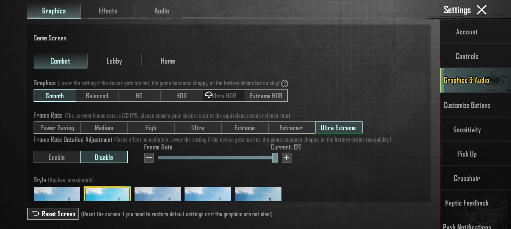

  
  
  
  

<h1>🎮 DOMINATE THE BATTLEFIELD 🎮</h1>

<b>Stop playing with lag. Start playing to win.</b> 
Unlock <b>Ultra Extreme 120 FPS</b> and <b>Extreme HDR</b> graphics in PUBG Mobile, BGMI and more, 
by making your phone identify itself as a <b>Redmagic 10 Pro</b>.

<i>PUBG Mobile with the module installed: Extreme HDR graphics and Ultra Extreme (120 FPS) frame rate unlocked.</i>

---

## 🚀 Features

* ✅ **Unlocks 90 / 120 FPS** (Ultra Extreme frame rate, where the game supports it)
* ✅ **Unlocks HDR / Extreme HDR graphics**
* ✅ **Redmagic 10 Pro device spoofing** (model `NX789J`)
* ✅ **Universal support** (PUBG, BGMI, CODM, Free Fire)
* ✅ **Tiny and clean**: changes only the phone's model name, nothing else
* ✅ **No thermal or kernel tweaks**: your phone's normal heat and battery protection stays in place

---

## 📦 Requirements

* A **rooted** Android phone
* **Magisk v20.4 or newer**, or **KernelSU** (APatch should also work, but it is not tested yet)
* A screen that supports **90 Hz or 120 Hz**, if you want to actually see 90 / 120 FPS

---

## 🛠️ Installation

### Magisk

1. Download the latest zip from the **[Releases page](https://github.com/shakilxt/ULTRA-EXTREME-UNLOCKER/releases/latest)**.
2. Open the **Magisk** app and go to **Modules**.
3. Tap **Install from storage** and select the downloaded zip.
4. Wait for the installation to finish, then **reboot**.

### KernelSU

1. Download the latest zip from the **[Releases page](https://github.com/shakilxt/ULTRA-EXTREME-UNLOCKER/releases/latest)**.
2. Open the **KernelSU** app and go to **Modules**.
3. Tap **Install** and select the downloaded zip.
4. Wait for the installation to finish, then **reboot**.

After restarting, launch your game and check the available graphics and FPS options.

### Uninstall

Open Magisk or KernelSU → **Modules** → remove **ULTRA EXTREME UNLOCKER** → **reboot**. Your phone goes back to its real model name.

---

## ❓ Troubleshooting & FAQ

<b>The new FPS or graphics options are not showing</b>

 

1. Make sure the module is **enabled** in Magisk / KernelSU and that you **rebooted** after installing.
2. Force stop the game and open it again.
3. If the options are still missing, clear the game's **cache** (Settings → Apps → the game → Storage → Clear cache). Do not clear **data** unless you are ready to download the game files again.
4. Games sometimes change their settings after an update. If it stopped working after a game update, please [open an issue](https://github.com/shakilxt/ULTRA-EXTREME-UNLOCKER/issues) with the game name and version.

<b>"Invalid module ID in module.prop" error when installing</b>

 

This was a bug in v0.0.2 and earlier. Download **v0.0.3 or newer** from the [Releases page](https://github.com/shakilxt/ULTRA-EXTREME-UNLOCKER/releases/latest).

<b>The game shows 120 FPS but it doesn't feel smoother</b>

 

Your screen's refresh rate must be set to **120 Hz** (or 90 Hz for 90 FPS). Check Settings → Display → Refresh rate on your phone.

<b>My phone gets hot or the battery drains faster</b>

 

Higher FPS and graphics make the GPU work harder, so more heat and battery use is expected. Choose a lower graphics or frame rate setting in the game if it gets too hot.

<b>Can I get banned for using this?</b>

 

The module only changes the model name and does not touch the game itself. Still, using root or a modified phone is always at your own risk. Please read the disclaimer below.

---

## 💬 Community

Join our **[Telegram](https://t.me/pubg120x)** for live updates.

---

## ⭐ Star History

<a href="https://star-history.com/#shakilxt/ULTRA-EXTREME-UNLOCKER&Date">
  <picture>
    <source media="(prefers-color-scheme: dark)" srcset="https://api.star-history.com/svg?repos=shakilxt/ULTRA-EXTREME-UNLOCKER&type=Date&theme=dark" />
    
  </picture>
</a>

---

## ⚠️ Disclaimer & Liability

> [!IMPORTANT]
> **USE AT YOUR OWN RISK.**
> Unlocking higher FPS may increase GPU load, battery drain, and device temperature. The developer (**shakilxt**) is not responsible for any device damage, account bans, data loss, warranty issues, or other consequences resulting from the use of this module.

### MADE WITH ❤️ BY SHAKILXT

⭐ If this module helped you, give the repo a star!

